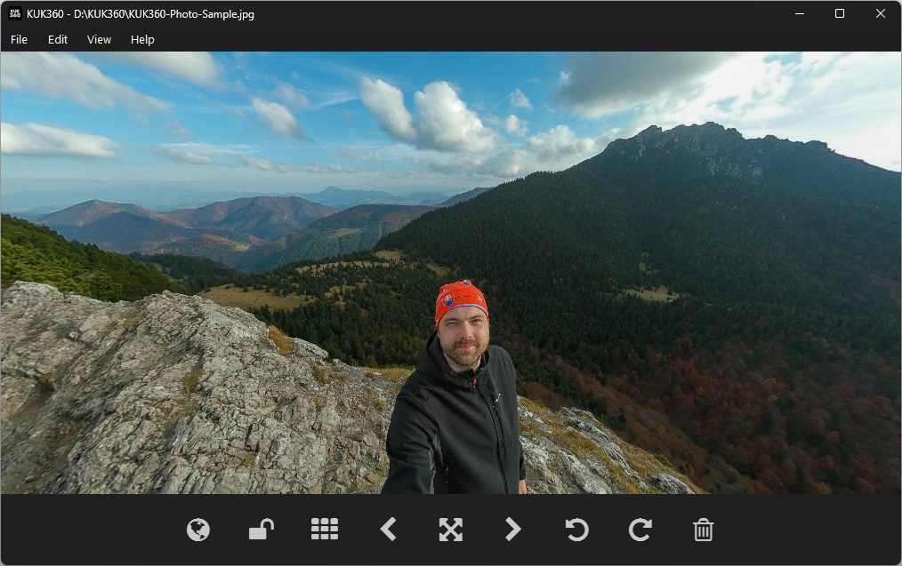
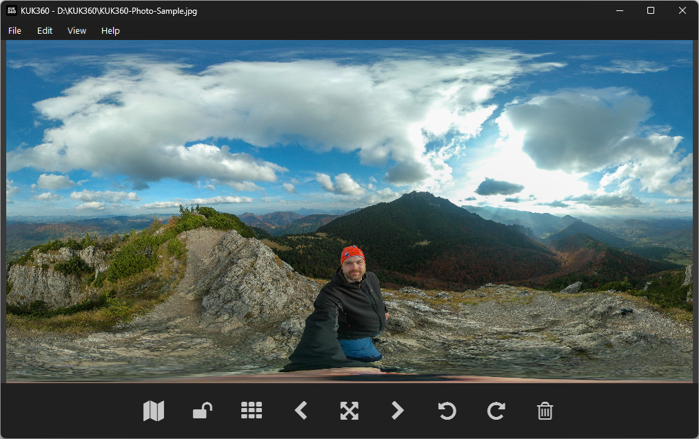

KUK360
======
**Simple 360 photo viewer**

## Overview

KUK360 can view any image in 360° projection and supports equirectangular/stitched photos taken by any 360° camera:



You can switch to a flat projection anytime you need to examine the stitching lines or overall quality of your photos:



## Features

- Open source and completely free
- Fast and lightweight JPEG, PNG, BMP, GIF, TIFF and WebP image viewer
- Supports equirectangular/stitched photos from any 360° camera
- Automatically detects 360° photos from their XMP metadata
- Views images in 360° or flat projection
- Seamlessly switches between images stored in the same folder
- Quickly deletes or copies image files
- Runs in windowed or full screen mode

## Download

You can download the [latest release](https://github.com/jariq/KUK360/releases/latest) right away. Complete list of changes between individual versions can be found in the [changelog](CHANGELOG.md).

If you're just exploring the world of 360° photography and you don't have your own photos yet, then consider downloading my [sample equirectangular photo](img/KUK360-Photo-Sample.jpg).

## Usage

Open an image with the "Open image..." button, by dropping it onto the window or with "Open with" in your file manager.

The view is controlled with the mouse (drag to look around, wheel to zoom) or with the keyboard:

| Key | Action |
|---|---|
| `Ctrl` + `O` | Open image |
| `F5` | Reload image |
| `Left` / `Right` | Previous / next image in the folder |
| `Ctrl` + `W` | Close image |
| `Ctrl` + `L` | Show in file manager |
| `Ctrl` + `C` | Copy image file to the clipboard |
| `DEL` | Move image file to the Trash / Recycle Bin |
| `F2` | Switch between 360° and flat projection |
| `F3` | Lock/unlock the projection for the next images |
| `F4` | Show/hide alignment grid |
| `W` / `A` / `S` / `D` | Look around in 360° projection |
| `E` / `Q` | Zoom in / out in 360° projection |
| `Ctrl` + `Plus` / `Ctrl` + `Minus` | Zoom in / out |
| `Ctrl` + `0` | Zoom to 100% |
| `L` / `R` | Rotate left / right |
| `F12` | Enter/exit full screen mode |
| `Escape` | Exit full screen mode |
| `F1` | About KUK360 |

On macOS, use `Cmd` instead of `Ctrl` and `Cmd` + `Backspace` instead of `DEL`.

The buttons at the bottom of the window, from left to right:

| Button | Key | Action |
|---|---|---|
| Globe / map | `F2` | Switch between 360° and flat projection; the icon shows the current projection |
| Open / closed lock | `F3` | Lock/unlock the projection; the closed lock keeps the current projection for the next images, the open lock detects it automatically |
| Grid | `F4` | Show/hide alignment grid |
| Left arrow | `Left` | Previous image in the folder |
| Arrows | `F12` | Enter/exit full screen mode |
| Right arrow | `Right` | Next image in the folder |
| Rotate left | `L` | Rotate the 360° view to the left automatically, or the flat view counterclockwise by 90° |
| Rotate right | `R` | Rotate the 360° view to the right automatically, or the flat view clockwise by 90° |
| Trash | `DEL` | Move image file to the Trash / Recycle Bin |

## Development

KUK360 is written in C++, requires OpenGL 2.1 and uses Qt 6.12 from the Qt installer on Windows (MinGW kit), macOS and Linux (Fedora).

Everything specific to one platform is in `build/<platform>`: build scripts, icons, resources, license files and tools of that platform. Each platform has a build script that rebuilds the release version from scratch; the build tree goes to `build/<platform>/buildroot` and the result to `build/<platform>/output`.

### Windows

Install Qt 6.12.0 into `C:\Qt\Qt6.12.0` with the MinGW kit, Qt Image Formats and the MinGW, CMake and Ninja tools, then run:

```
build\windows\build.bat
```

The application with all its runtime dependencies and license files is then in `build\windows\output\release\KUK360` and `KUK360.exe` runs from there by double-click.

### macOS

Install Xcode and Qt 6.12.0 into `~/Qt/Qt6.12.0` with Qt Image Formats and the CMake and Ninja tools, then run:

```
build/macos/build.sh
```

The result is a self-contained universal `KUK360.app` for macOS 14.4 or newer in `build/macos/output/release`.

### Linux

Install the C++ compiler, the OpenGL and EGL headers, `mksquashfs` and the X11 libraries that KUK360 ships with it:

- Fedora: `gcc-c++ libglvnd-devel squashfs-tools xcb-util xcb-util-cursor xcb-util-image xcb-util-keysyms xcb-util-renderutil xcb-util-wm`
- Debian and Ubuntu: `g++ libgl-dev libegl-dev squashfs-tools libxcb-cursor0 libxcb-icccm4 libxcb-image0 libxcb-keysyms1 libxcb-render-util0 libxcb-shape0 libxcb-util1 libxcb-xkb1`

Install Qt 6.12.0 into `~/Qt/Qt6.12.0` with Qt Image Formats and the CMake and Ninja tools, then run:

```
build/linux/build.sh
```

The result is `KUK360-<version>-x86_64.AppImage` in `build/linux/output/release`, next to the unpacked `KUK360.AppDir`. The AppImage runs on this system and on distributions with the same or a newer glibc.

## License

KUK360 is free software available under the terms of the GNU General Public License version 3 only (GPL-3.0-only).
Human friendly [license summary](https://www.tldrlegal.com/license/gnu-general-public-license-v3-gpl-3) is available at tldrlegal.com but the [full license text](LICENSE) always prevails.
Please note that KUK360 also uses various 3rd party components with their own respective licenses that are all present in the [3rd party notices](THIRD_PARTY_NOTICES.txt).

## Support

Please use the [issue tracker](https://github.com/jariq/KUK360/issues) to report any problems or suggest improvements.

## About

KUK360 has been initially written in C# / WPF by [Jaroslav Imrich](https://www.jimrich.sk) and then ported to C++ / Qt with the massive help of [Claude Code](https://code.claude.com/).
